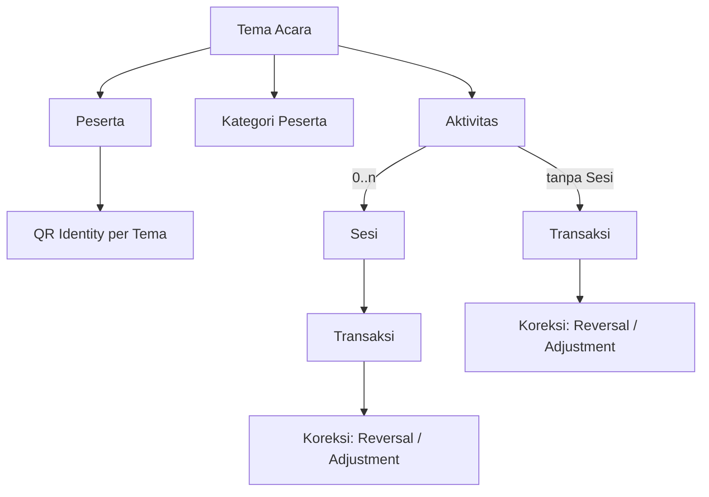

# ARCHITECTURE — QRCek

> **Status:** Draft v1 — diselaraskan dengan [`REQUIREMENTS.md`](./REQUIREMENTS.md) v0.3.1 (3 November 2026).
> **Baseline kode:** commit `157c330` (lihat `REQUIREMENTS.md` §7).
> **Menggantikan:** `docs/ARSITEKTUR.md` (dipindah ke file ini pada 3 November 2026; ADR inline diekstrak ke [`adr/`](./adr/)).
> **Sifat dokumen:** rancangan arsitektur, boundary, dan model sistem. Dokumen ini **tidak** menetapkan kebutuhan produk (sumbernya `REQUIREMENTS.md`) dan **tidak** mencatat keputusan individual (indeksnya [`DECISIONS.md`](./DECISIONS.md), isinya di `adr/`).

Dokumen terkait: [`DECISIONS.md`](./DECISIONS.md), [`IMPLEMENTATION_ROADMAP.md`](./IMPLEMENTATION_ROADMAP.md), [`DESAIN_API.md`](./DESAIN_API.md), [`DESAIN_DATABASE.md`](./DESAIN_DATABASE.md), [`RENCANA_PENGUJIAN.md`](./RENCANA_PENGUJIAN.md), [`OPERASIONAL.md`](./OPERASIONAL.md), [`../COSTS_AND_LIMITS.md`](../COSTS_AND_LIMITS.md).

---

## 0. Cara membaca

| Label | Arti di dokumen ini |
|---|---|
| **Baseline** | Arsitektur yang benar-benar berjalan pada commit acuan. Masih berlaku sampai diganti lewat roadmap. |
| **Target** | Bentuk sistem yang dibutuhkan `REQUIREMENTS.md`. Belum diimplementasikan kecuali disebut lain. |
| **AQ-xxx** | Pertanyaan arsitektur terbuka (§6). Tidak boleh dijawab diam-diam saat menulis kode; jawabannya dicatat sebagai ADR baru. |
| `[A]` / `[P]` / `[O]` | Status keputusan produk, mengikuti `REQUIREMENTS.md` §0.2. `[P]` belum boleh diperlakukan sebagai final. |

Kode `FR-`, `BR-`, `NFR-`, `AC-`, `D-`, dan `OQ-` merujuk ke `REQUIREMENTS.md`. Dokumen ini tidak menyalin isinya.

---

## 1. Tujuan dan batasan yang mengikat

QRCek adalah sistem kehadiran dan distribusi konsumsi berbasis QR untuk Tema Acara yang memiliki banyak Aktivitas dan Sesi (`REQUIREMENTS.md` §1). Admin Acara mengelola Tema, Petugas memindai QR peserta di lokasi.

Batasan yang membentuk seluruh desain:

| Batasan | Sumber | Konsekuensi arsitektural |
|---|---|---|
| Tidak ada layanan berbayar | `AGENTS.md` #1, `NFR-009` | Tanpa queue, Durable Objects berbayar, SaaS auth, email transaksional |
| Workers Free: **10 ms CPU/request** | `NFR-010` | Tidak ada KDF mahal, tidak ada render gambar/PDF/arsip berat di Worker |
| D1 Free: **50 query per invokasi** | `NFR-011` | Endpoint dirancang dengan statement sedikit; operasi atomik via `db.batch()` |
| D1 Free: **500 MB per database** | `NFR-012` | Skema hemat byte; retensi audit wajib dipikirkan (ADR-0008) |
| D1 = SQLite tanpa transaksi interaktif | `AGENTS.md` | Invariant ditegakkan dengan constraint/indeks + `batch()`, bukan "cek lalu tulis" |
| Kamera hanya di secure context; iOS butuh gesture | `NFR-014`, `NFR-015` | HTTPS wajib; kamera dibuka oleh aksi pengguna |
| iOS Safari tanpa `BarcodeDetector` | — | Decoder QR pure-JS (`@zxing/browser`) dibundel |
| Scanner online saja | `FR-122`, `NG-06` | Tidak ada antrean transaksi offline |

---

## 2. Keputusan arsitektur

Isi keputusan ada di `adr/`; status dan relasinya dengan keputusan produk ada di [`DECISIONS.md`](./DECISIONS.md).

| ADR | Ringkas | Status |
|---|---|---|
| [ADR-0001](./adr/0001-single-worker-same-origin.md) | Satu Worker same-origin (SPA + `/api/*`) | Diterima |
| [ADR-0002](./adr/0002-passwordless-token-auth.md) | Auth passwordless berbasis token, cookie `HttpOnly` | Diterima |
| [ADR-0003](./adr/0003-opaque-qr-token.md) | QR = token opaque, lookup hash di server | Diterima; scope diperbarui oleh `D-004` [A] |
| [ADR-0004](./adr/0004-sheets-upsert-projection.md) | Sheets = proyeksi/upsert per peserta | Diterima untuk baseline; ditinjau `D-017` [A], AQ-011 |
| [ADR-0005](./adr/0005-d1-outbox-cron.md) | Outbox D1 + Cron Trigger | Diterima |
| [ADR-0006](./adr/0006-qr-credential-hash-ciphertext.md) | Kredensial QR: hash + ciphertext AES-GCM | Diterima |
| [ADR-0007](./adr/0007-event-admin-self-signup.md) | Pendaftaran mandiri admin acara ber-scope nol | Digantikan oleh ADR-0013 |
| [ADR-0008](./adr/0008-audit-log-retention.md) | Audit append-only permanen, arsip manual | Diterima |
| [ADR-0009](./adr/0009-events-baseline-hierarchy-mapping.md) | `events` = Tema Acara; Aktivitas/Sesi additive | Diterima (AQ-001) |
| [ADR-0010](./adr/0010-schema-migration-strategy.md) | Migrasi additive `0007_*` dst. | Diterima (AQ-010) |
| [ADR-0011](./adr/0011-audit-allowlist-mechanism.md) | Allowlist field audit di `packages/shared` | Diterima (AQ-014) |
| [ADR-0012](./adr/0012-activity-session-lifecycle.md) | Tabel transisi lifecycle Aktivitas/Sesi | Diterima (detail `D-010`) |
| [ADR-0013](./adr/0013-disable-public-self-signup.md) | Registrasi Admin Acara hanya via undangan; Turnstile dihapus | Diterima; menggantikan ADR-0007 |

---

## 3. Topologi dan komponen

```
┌──────────────────────────────────────────────┐
│ Browser (HP petugas/kiosk, laptop admin)     │
│  React SPA + Tailwind + shadcn/ui            │
│  - kamera: BarcodeDetector → fallback ZXing  │
│  - render QR (SVG/PNG) dan cetak di browser  │
└───────────────┬──────────────────────────────┘
                │ HTTPS, cookie HttpOnly, same-origin
┌───────────────▼──────────────────────────────┐
│ Cloudflare Worker `qrcek` (apps/api)         │
│  router → security → auth → handler → domain │
│  ├─ Static Assets (SPA)                      │
│  ├─ /api/*  (semua otorisasi di sini)        │
│  └─ scheduled()  ← Cron Trigger              │
└──────┬───────────────────────┬───────────────┘
       │ D1 binding `DB`       │ fetch (service account JWT)
┌──────▼───────┐        ┌──────▼──────────────┐
│ D1 (SQLite)  │        │ Google Sheets API   │
│ absensi-db   │        │ (opsional)          │
└──────────────┘        └─────────────────────┘
```

### 3.1 Pembagian tanggung jawab

| Lapisan | Lokasi | Isi |
|---|---|---|
| `domain/` | `apps/api/src/domain/` | Fungsi murni: aturan kehadiran, transisi status, token, CSV, kebijakan outbox. **Tanpa I/O.** Target: resolver entitlement, validasi konteks/lifecycle, aturan kuota, allowlist audit. |
| `db/` | `apps/api/src/db/` | Semua SQL. Tidak ada SQL di luar folder ini. |
| `routes/` | `apps/api/src/routes/` | Parse → validasi (zod) → panggil domain/db → bentuk respons. Satu file per resource. |
| `http/` | `apps/api/src/http/` | Router, CSRF/Origin, cookie, auth, error, security headers. |
| `services/` | `apps/api/src/services/` | Orkestrasi lintas modul (outbox, housekeeping). |
| `integrations/` | `apps/api/src/integrations/` | Klien pihak ketiga. Saat ini kosong: klien Turnstile dihapus bersama registrasi publik (ADR-0013), dan gateway Sheets ada di `domain/sheets.ts` di balik interface agar bisa di-fake. |
| UI | `apps/web/src/` | Presentasi + pemanggilan API. **Tanpa aturan bisnis.** Guard React hanya UX. |
| Kontrak | `packages/shared/` | Skema zod, tipe request/response, konstanta batas. Dipakai web dan api. |

### 3.2 Dependensi runtime aktual

| Paket | Workspace | Untuk | Kenapa tidak dibuat sendiri |
|---|---|---|---|
| `zod` | shared | Validasi runtime di boundary | `AGENTS.md` mewajibkan validasi runtime; tipe TS tidak memvalidasi saat runtime |
| `react`, `react-dom` | web | UI | Bagian dari spesifikasi stack |
| `qrcode-generator` | web | Encoder QR | Encoder QR (Reed-Solomon, mode) berisiko dibuat sendiri; SVG dibangun sendiri |
| `@zxing/browser` | web | Decoder fallback | `BarcodeDetector` tidak tersedia di Safari/iOS |
| `lucide-react` | web | Ikon | Spesifikasi stack (`FR-156`) |

Dev: Tailwind v4, `class-variance-authority`, `clsx`, `tailwind-merge` (pola shadcn/ui), Vite, Wrangler, Vitest, `@cloudflare/vitest-plugin`.

Router Worker, router SPA, dan state server ditulis sendiri (tidak ada Hono, React Router, atau React Query). Yang sengaja **tidak** ditambahkan: ORM, Jest, axios, moment/dayjs, library PDF. Calon dependensi target (ZIP/PNG untuk `D-016` [A], XLSX untuk `D-015` [A], font Geist untuk `D-021` [A]) wajib dievaluasi terhadap Web API dan kode sendiri lebih dulu (`NFR-020`).

---

## 4. Struktur folder (baseline)

```
absensi/
├── AGENTS.md                    # aturan agent (mengikat)
├── README.md                    # apa ini, jalan lokal, deploy
├── COSTS_AND_LIMITS.md          # batas free tier (lokasi final: OQ-027 [O])
├── IMPLEMENTATION_PLAN.md       # ARSIP historis Fase 0–6 (D-002 [A])
├── PLAN_TAB_PESERTA.md          # dokumen kerja historis; dievaluasi di roadmap Q2/Q4
├── package.json                 # npm workspaces + script kanonik
├── migrations/                  # 0001–0006 (jangan diedit)
├── docs/
│   ├── REQUIREMENTS.md          # sumber kebutuhan produk
│   ├── ARCHITECTURE.md          # dokumen ini
│   ├── DECISIONS.md             # indeks keputusan + AQ
│   ├── adr/                     # 0001–0008
│   ├── IMPLEMENTATION_ROADMAP.md
│   ├── DESAIN_API.md · DESAIN_DATABASE.md · RENCANA_PENGUJIAN.md · OPERASIONAL.md
│   └── RISET_KOMPONEN_UI_OPENCODE.md   # arsip riset
├── .opencode/                   # agent, command, skill, plans/
├── packages/shared/src/         # schemas/, attendance, events, participants, labels, sync, audit, admin, auth, security
├── apps/api/
│   ├── wrangler.jsonc · wrangler.test.jsonc
│   └── src/
│       ├── index.ts · app.ts (tabel ROUTES + alias /api/calendar)
│       ├── http/ · routes/ · domain/ · db/ · services/ · integrations/
│       └── test/
└── apps/web/src/
    ├── App.tsx · main.tsx · index.css
    ├── pages/ · components/ · components/ui/ (shadcn/ui)
    └── lib/ (router, navigation, api, http, scanner, qr-labels, …)
```

Aturan: **satu file route = satu resource**.

---

## 5. Model domain target

> Target dari `REQUIREMENTS.md` §3 dan `D-003`–`D-007` [A]. Bagian ini sengaja **tidak** menetapkan tabel, kolom, atau payload; itu jawaban AQ di §6.

### 5.1 Hierarki



| Konsep | Aturan inti | Rujukan |
|---|---|---|
| Tema Acara | Entitas utama; mengelompokkan peserta, kategori, aktivitas, konfigurasi, transaksi | `FR-001`–`FR-004`, `D-003` [A] |
| Aktivitas | Di bawah satu Tema; nol/satu/banyak Sesi; satu tipe transaksi utama | `FR-005`–`FR-008`, `FR-182` (`D-009` [A]) |
| Sesi | Milik satu Aktivitas; tidak lintas Aktivitas; tidak disimpulkan dari jam | `FR-009`–`FR-012`, `FR-187` |
| Peserta | Terdaftar di Tema; Participant ID dibuat sistem, tetap, unik dalam Tema | `FR-013`–`FR-025`, `BR-010` |
| QR Identity | Satu per Tema + Peserta; token opaque; rotasi membatalkan token lama | `FR-054`–`FR-062`, `D-004` [A] |
| Entitlement | Lima tingkat prioritas + Inherit/Allowed/Denied; future-only | `FR-037`–`FR-045`, `FR-199`, `D-005` [A] |
| Transaksi | Type (Attendance/Consumption) × Source (QR Scan/Manual Entry) | `FR-072`, `FR-089` (`D-011` [A]) |
| Correction Operation | Reversal/Adjustment; bukan Source; transaksi asli tetap ada | `FR-076`–`FR-080`, `D-006` [A] |
| Effective Transaction | Belum di-reversal; dasar duplikasi dan kuota | `BR-032`, `BR-044`, `D-006` [A] |

### 5.2 Invariant yang harus ditegakkan oleh arsitektur

| Invariant | Penegak yang disyaratkan | Rujukan |
|---|---|---|
| Satu transaksi Attendance efektif per peserta per ruang lingkup (Aktivitas tanpa Sesi, atau Sesi) | **Constraint database**, bukan cek aplikasi | `FR-068`, `FR-075`, `FR-165`, `BR-032`, `BR-033` |
| Consumption tidak melebihi kuota efektif | Database + backend; cooldown frontend tidak cukup | `FR-086`, `BR-044`, `D-014` [A] |
| Konteks transaksi konsisten (Sesi milik Aktivitas, Aktivitas milik Tema, peserta & petugas di Tema yang sama) | Validasi backend di setiap transaksi; query selalu di-scope Tema | `FR-188`, `BR-003`, `AC-003` |
| Transaksi asli tidak pernah dihapus/ditimpa | Tidak ada `UPDATE`/`DELETE` destruktif pada transaksi; koreksi = baris baru | `FR-079`, `BR-038`, `BR-066` |
| Koreksi + audit dalam satu request | `db.batch()` yang sama | `FR-080`, `AGENTS.md` |
| Audit append-only, tanpa PII/secret, before/after hanya field allowlist | Trigger DB + allowlist di kode bersama | `FR-137`, `FR-195`, `FR-207` |
| Waktu disimpan UTC | Konvensi skema (`INTEGER` ms epoch) | `NFR-013` |

### 5.3 Urutan validasi transaksi (target)

Urutan ini adalah kerangka; pemetaan setiap penolakan ke result code (`D-011` [A]) adalah AQ-008.

1. Sesi pengguna valid (cookie + hash) dan CSRF/Origin lulus.
2. Pengguna berwenang pada konteks: Petugas ditugaskan pada Aktivitas/Sesi itu, atau Admin Acara Tema itu (`FR-100`, `FR-127`, `D-012` [A]). URL hanya preselect, bukan otorisasi (`FR-190`).
3. Konteks konsisten: Aktivitas milik Tema; bila Aktivitas punya Sesi, Sesi wajib ada dan milik Aktivitas (`FR-185`, `FR-188`).
4. Lifecycle mengizinkan transaksi (`FR-183`–`FR-186`, `FR-206`; `D-010` [A]).
5. Token QR di-hash dan dicari **dalam Tema konteks** (`FR-058`, `D-004` [A]).
6. Peserta aktif (`FR-021`–`FR-023`).
7. Entitlement di-resolve (`FR-043`, prioritas `D-005` [A]).
8. Tulis transaksi + audit (+ outbox bila sync aktif) dalam satu `db.batch()`; pelanggaran constraint duplikasi/kuota dipetakan menjadi hasil bisnis, bukan 500 (`AGENTS.md`).
9. Respons membawa result code stabil; UI hanya menampilkan sukses setelah respons ini (`FR-071`, `BR-072`).

Batas anggaran: langkah 1–8 harus muat dalam statement D1 yang sedikit dan CPU jauh di bawah 10 ms; resolver entitlement harus murni dan tidak N+1 (AQ-005).

### 5.4 Baseline vs target (ringkas)

Matriks lengkap ada di `REQUIREMENTS.md` §8.2; ringkasan dampak arsitekturnya:

| Area | Baseline | Target | Dampak |
|---|---|---|---|
| Konteks | `events` datar | Tema → Aktivitas → Sesi | Skema baru (AQ-001, AQ-010) |
| Kehadiran | `attendance` satu baris per `(event_id, participant_id)` | Transaksi per ruang lingkup + koreksi non-destruktif | Constraint baru (AQ-002, AQ-003, AQ-004) |
| Koreksi | `UPDATE attendance` + snapshot audit | Reversal/Adjustment baris baru | Ganti jalur koreksi (Q5) |
| Kategori | Teks bebas `participants.category` | Entitas per Tema + entitlement | AQ-005, AQ-006 |
| Penugasan Petugas | Membership per acara | Penugasan per Aktivitas/Sesi | AQ-007 |
| Hasil scan | `present`/`duplicate`/`not_found`/`wrong_event`/`event_closed`/`participant_inactive` | `SUCCESS`/`DUPLICATE`/`NOT_ENTITLED`/`INVALID_QR`/`SYSTEM_ERROR` (`D-011` [A]) | AQ-008 |
| QR | Per baris peserta per acara | Per Tema + Peserta | AQ-009 |
| Sheets | Satu baris per peserta, satu sel kehadiran | Opsional per Tema (`D-017` [A]) | AQ-011 |
| Audit | Snapshot before/after | Allowlist field (`FR-207`) | AQ-014 |

---

## 6. Pertanyaan arsitektur terbuka (AQ)

Setiap AQ harus dijawab dengan ADR baru (`adr/NNNN-*.md`) **sebelum** fase roadmap yang diblokirnya dibuka. Opsi di bawah adalah bahan diskusi, bukan rekomendasi final. Status: **AQ-001, AQ-006, AQ-010, dan AQ-014 dijawab** oleh ADR-0009/0014/0010/0011 (Diterima); AQ lainnya **Terbuka**.

### AQ-001 — Posisi `events` baseline dalam hierarki target

- **Pertanyaan:** `events` menjadi Tema Acara, atau Tema Acara adalah entitas baru dan `events` menjadi Aktivitas/dipensiunkan? (`REQUIREMENTS.md` §3.4)
- **Opsi:** (a) `events` = Tema — reuse membership, undangan, peserta, QR paling besar; lifecycle acara perlu dipetakan ke lifecycle Tema. (b) Tema baru di atas — model bersih, tetapi hampir semua route `/api/events/:eventId/...` berubah.
- **Masukan:** `D-003` [A], `D-007` [A] (tanpa kewajiban migrasi data produksi), `FR-172`–`FR-175` (reuse dievaluasi).
- **Status:** dijawab **ADR-0009** (Opsi 1: `events` = Tema).
- **Memblokir:** Q1.

### AQ-002 — Representasi transaksi Attendance dan Consumption

- **Pertanyaan:** satu tabel transaksi dengan kolom tipe, atau tabel terpisah per tipe? (`REQUIREMENTS.md` §3.4)
- **Pertimbangan:** laporan gabungan dan audit lebih sederhana dengan satu tabel; constraint duplikasi (Attendance) dan kuota (Consumption) berbeda bentuk.
- **Masukan:** `D-009` [A], `D-011` [A].
- **Memblokir:** Q5, Q6.

### AQ-003 — Penegakan "transaksi efektif" di database

- **Pertanyaan:** bagaimana constraint unik hanya berlaku untuk transaksi yang belum di-reversal, untuk ruang lingkup Aktivitas-tanpa-Sesi maupun Sesi?
- **Catatan teknis:** SQLite menganggap `NULL` berbeda dalam indeks unik, sehingga `session_id NULL` tidak bisa langsung dipakai sebagai kunci ruang lingkup. Partial unique index wajib mengulang predikatnya di `ON CONFLICT` (temuan Fase 0, `OPERASIONAL.md` §4.1).
- **Opsi awal:** (a) kolom kunci ruang lingkup non-null + partial unique index `WHERE` belum di-reversal; (b) tabel "slot efektif" terpisah yang dilepas oleh reversal dalam batch yang sama; (c) untuk kuota > 1: nomor slot `1..kuota` unik per ruang lingkup efektif. Perubahan kuota setelah transaksi adalah pertanyaan produk terbuka di `D-014` [A].
- **Masukan:** `D-006` [A], `D-014` [A], `FR-075`, `FR-165`.
- **Memblokir:** Q5, Q6. Tes konkuren wajib (`RENCANA_PENGUJIAN.md` §9).

### AQ-004 — Struktur Reversal dan Adjustment

- **Pertanyaan:** bentuk data operasi koreksi, field transaksi apa yang boleh di-Adjust, dan bagaimana efektivitas dihitung. (`D-011` [A] "struktur data rinci")
- **Catatan:** baseline punya status kehadiran `present/late/absent/excused`; `REQUIREMENTS.md` tidak menetapkan status Attendance di luar "tercatat hadir". Field yang boleh di-Adjust memerlukan masukan product owner.
- **Masukan:** `D-006` [A], `FR-079`, `FR-202`, `FR-207`.
- **Memblokir:** Q5.

### AQ-005 — Representasi dan resolusi entitlement

- **Pertanyaan:** bentuk penyimpanan aturan lima tingkat (Individual/Category × Session/Activity + Theme default) dengan status Inherit/Allowed/Denied, dan cara me-resolve-nya per scan dalam anggaran query/CPU.
- **Sub-pertanyaan produk:** bagaimana `FR-040`/`FR-041` ditegakkan — apakah Aktivitas tidak boleh diaktifkan sebelum semua kategori dikonfigurasi eksplisit? **Sudah diputuskan** (8 November 2026): Aktivitas `draft` boleh ada, tetapi `draft → active` ditolak sampai setiap kategori aktif punya baris eksplisit; kategori baru fail-closed sampai dikonfigurasi; Theme default hanya fallback lewat `inherit`.
- **Arah wajib:** resolver adalah fungsi murni di `domain/` dengan tes tabel lengkap (`AC-011`); data yang dibutuhkan diambil dengan sedikit query terindeks.
- **Status:** **dijawab** — [ADR-0016](./adr/0016-entitlement-resolution.md) (Diterima 8 November 2026): satu tabel `entitlement_rules`, lima partial unique index, resolver murni, default deny, dan gate kelengkapan `draft → active`. Migrasi `0009` additive dengan backfill `allowed` untuk Aktivitas lama.
- **Masukan:** `D-005` [A].
- **Membuka:** Q3 (dibuka 8 November 2026).

### AQ-006 — Kategori dan custom field

- **Pertanyaan:** entitas kategori per Tema; penyimpanan definisi dan nilai custom field (9 tipe, required, urutan, aktif/nonaktif, arsip, validasi perubahan tipe); pemisahan field khusus Aktivitas (`FR-033`).
- **Masukan historis:** `PLAN_TAB_PESERTA.md` §3–4 mengusulkan katalog field per acara + `attributes_json` (menolak EAV karena biaya baris tulis). Usulan itu hanya mendukung nilai teks dan katalog "hanya bertambah", sehingga belum memenuhi `FR-027`–`FR-032`; perlu dievaluasi ulang, bukan disalin.
- **Masukan:** `FR-026`–`FR-036`, `COSTS_AND_LIMITS.md` §3.3.
- **Status:** **dijawab** — [ADR-0014](./adr/0014-categories-and-custom-fields.md) (Diterima 6 November 2026): katalog `custom_fields` + `participants.attributes_json` (bukan EAV), kategori sebagai entitas per Tema, nilai field Aktivitas menempel pada penugasan Q3, batas 50 field/100 opsi, dan `category_id` wajib.
- **Memblokir:** Q2.

### AQ-007 — Penugasan Petugas dan matriks izin

- **Pertanyaan:** keanggotaan per Tema + penugasan per Aktivitas/Sesi; izin Manual Check-in per Petugas (`D-022` [A]); evolusi `domain/permissions.ts`.
- **Aturan yang sudah pasti:** koreksi hanya Admin Acara (`D-006` [A]); izin legacy `attendance:correct` **tidak boleh** dipakai ulang sebagai izin Manual Check-in target (`AC-055`, `OQ-034` [A]).
- **Memblokir:** Q5 (manual entry), Q7.

### AQ-008 — Kontrak hasil scan

- **Pertanyaan:** pemetaan setiap penolakan (peserta nonaktif, QR dirotasi, konteks salah, lifecycle tertutup, tidak ditugaskan) ke lima result code `D-011` [A], serta pemetaan ke HTTP status. `REQUIREMENTS.md` belum menetapkan kode untuk peserta nonaktif atau Sesi yang belum Berlangsung — perlu masukan product owner.
- **Baseline:** hasil bisnis selalu HTTP 200 dengan enum lama (§7.5).
- **Memblokir:** Q5, Q7.

### AQ-009 — Kepemilikan kredensial QR per Tema

- **Pertanyaan:** di entitas mana kredensial QR melekat agar scope Tema + Peserta (`D-004` [A]) terpenuhi, dan bagaimana rotasi token per peserta (`FR-059`, `FR-062`) dirancang. Bergantung AQ-001.
- **Tetap berlaku:** ADR-0003, ADR-0006, prefix `absensi:v1:` (`D-019` [A]).
- **Memblokir:** Q4.

### AQ-010 — Strategi skema menuju model baru

- **Pertanyaan:** migrasi additive bertahap (`0007_*` dan seterusnya, tabel lama dipensiunkan setelah penggantinya teruji) atau set migrasi baru dengan reset database remote.
- **Fakta yang mengikat:** remote sudah menerapkan `0001`–`0006`; migrasi yang sudah dijalankan **tidak boleh diedit**; `db:migrate:remote` dan reset remote butuh konfirmasi eksplisit pemilik proyek; constraint duplikasi lama tidak boleh dilepas sebelum penggantinya ada dan teruji. `D-007` [A] menghapus kewajiban migrasi data, bukan kewajiban regression test.
- **Status:** dijawab **ADR-0010** (Opsi 1: additive).
- **Memblokir:** Q1.

### AQ-011 — Proyeksi Google Sheets untuk Sesi dan Consumption

- **Pertanyaan:** bentuk spreadsheet per Tema (tab per Aktivitas? kolom per Sesi?) yang tetap idempoten (ADR-0004) dan hemat kuota.
- **Masukan:** `D-017` [A].
- **Memblokir:** Q10.

### AQ-012 — Pesan scanner yang dapat dikonfigurasi

- **Pertanyaan:** penyimpanan template pesan per Tema (`FR-120`), substitusi variabel `{nama}`, `{id}`, `{acara}`, `{waktu}` (`FR-121`) di browser atau server, dan batas data peserta yang boleh dikirim ke perangkat kiosk.
- **Masukan:** `D-012` [A], `D-013` [A], aturan "jangan log PII".
- **Memblokir:** Q7.

### AQ-013 — Pembuatan laporan dan ekspor

- **Pertanyaan:** CSV dibangun di Worker (streaming/paginasi) atau di browser; dependensi XLSX (`D-015` [A]); batas baris agar muat CPU 10 ms.
- **Baseline:** ekspor CSV kehadiran (≤ 5.000 baris) dan peserta dibangun di Worker.
- **Memblokir:** Q8.

### AQ-014 — Mekanisme allowlist audit

- **Pertanyaan:** di mana allowlist field per tipe objek didefinisikan (kandidat: konstanta di `packages/shared`), bagaimana penanda "berubah" untuk field sensitif disimpan, dan bagaimana audit baseline yang menyimpan snapshot diganti.
- **Alasan diputuskan awal:** setiap fase menambah mutasi yang wajib diaudit (`FR-135`); menunda keputusan ini berarti merombak audit berulang kali.
- **Masukan:** `FR-207`, `D-023` [A], `NFR-006`.
- **Status:** dijawab **ADR-0011** (Opsi 1: allowlist konstanta di `packages/shared`).
- **Memblokir:** Q1 (audit mutasi Tema/Aktivitas/Sesi pertama).

---

## 7. Alur utama (baseline)

Alur di bawah adalah perilaku kode saat ini. Catatan **Target** menunjukkan bagian yang akan berubah.

### 7.0 Prinsip database baseline

Detail: [`DESAIN_DATABASE.md`](./DESAIN_DATABASE.md).

1. Kehadiran ganda = pelanggaran unique index `UNIQUE (event_id, participant_id)` pada `attendance`. **Target:** constraint per transaksi efektif per ruang lingkup (AQ-003). Constraint lama tetap dipertahankan sampai penggantinya ada.
2. Isolasi acara di level query: setiap statement yang menyentuh data acara menyertakan `event_id = ?`.
3. Audit append-only: trigger `audit_log_no_update` / `audit_log_no_delete` (`RAISE(ABORT)`).
4. Semua timestamp `INTEGER` milidetik UTC.

### 7.1 Membuat acara

1. `POST /api/events` (nama, deskripsi, jadwal, timezone, `allow_manual`). Superadmin, atau `event_admin` tanpa keanggotaan (ADR-0007).
2. Worker memvalidasi dengan `eventCreateSchema`, membuat slug, dan menulis `events` + keanggotaan pemilik dalam satu `db.batch()`.
3. Status awal `draft`. Transisi sah: `draft → active → closed → active|archived`; `archived` final; `active → archived` ditolak. Tabel transisi di `packages/shared/src/events.ts`.
4. `DELETE` hanya superadmin, hanya `draft` tanpa peserta.

**Target:** Tema/Aktivitas/Sesi dengan lifecycle terpisah (`FR-090`–`FR-096`; AQ-001).

### 7.2 Undangan petugas/admin via QR

1. `POST /api/events/:id/invites` dengan `role` dan `expires_in_hours` (default 72, maksimum 168).
2. Server membuat token 128-bit, menyimpan HMAC, mengembalikan token **sekali**.
3. Klien merender QR `https://<host>/aktivasi#t=<token>` (token di fragment, tidak tercatat di log/referrer).
4. `POST /api/auth/activate` memverifikasi token (ada, belum dipakai, belum kedaluwarsa, acara `active`/`draft`) dan dalam satu `db.batch()` menandai undangan terpakai, membuat/membaca user, keanggotaan, kredensial perangkat, sesi, kode pemulihan, dan audit.
5. Kode pemulihan ditampilkan sekali. Undangan terpakai tidak bisa dipakai ulang.

**Target:** penugasan per Aktivitas/Sesi (AQ-007); undangan Admin Acara oleh Super Admin (`D-018` [A]).

### 7.3 Import peserta CSV

1. `POST /api/events/:eventId/participants/import?dry_run=true` (default).
2. Batas 2 MB dan 1.000 baris; decode UTF-8 (BOM dihapus); delimiter `,`/`;`; header tetap 6 kolom.
3. Dry run mengembalikan ringkasan tanpa menulis.
4. `?dry_run=false` menulis baris valid dalam satu `db.batch()` dengan upsert `ON CONFLICT (event_id, external_ref) WHERE external_ref IS NOT NULL`.
5. Duplikasi dalam file dilaporkan dan dilewati; baris valid lain tetap disimpan.
6. Import tidak menyentuh kolom QR. Rate limit konfirmasi 10/jam per acara.

**Target:** pemetaan kolom, peninjauan duplikat Skip/Update dengan konfirmasi, External Reference sebagai kunci, field kosong tidak menghapus (`FR-047`–`FR-053`, `FR-205`; `D-008` [A], `D-020` [A]). Catatan: upsert otomatis baseline bertentangan dengan `FR-050` bila `D-008` disetujui.

### 7.4 Mencetak label QR

`POST /api/events/:eventId/participants/qr-labels` dengan `{ format, participantIds?, limit?, cursor? }`.

1. Otorisasi `qr:print` (admin acara/superadmin) dan scope `event_id`.
2. Hanya peserta aktif; maksimal 50 per request.
3. Kredensial dibuat lazy (`UPDATE ... WHERE qr_token_hash IS NULL`) atau didekripsi ulang; token sama → QR sama.
4. Respons hanya `participantId`, `qr`, dan field label terpilih — tanpa hash/ciphertext/kunci.
5. Audit `qr.labels_exported` mencatat jumlah dan format, tanpa token.

Konfigurasi field label per acara di `event_label_config`; format A4 3 × 8 dan stiker 50 × 30 mm via `window.print()`.

**Target:** unduhan PNG individual dan ZIP dirakit di browser (`FR-063`–`FR-065`, `D-016` [A]). Tidak ada generator PDF (`NG-04`, `NG-05`). Apakah fitur cetak label dipertahankan adalah evaluasi reuse (`FR-172`) di roadmap Q4.

### 7.5 Pemindaian QR

`POST /api/events/:eventId/scan` dengan `{ qr: "absensi:v1:<token>" }`.

1. Cek sesi + user + keanggotaan (join).
2. `HMAC(QR_PEPPER, token)`; cari peserta berdasarkan hash **dan** `event_id`. Tidak ketemu → `not_found`; ketemu di acara lain → `wrong_event` + audit `attendance.wrong_event`.
3. Cek status acara dan jendela waktu → `event_closed`; peserta nonaktif → `participant_inactive`.
4. `db.batch()`: `INSERT INTO attendance ... ON CONFLICT DO NOTHING`, outbox, audit.
5. `changes = 1` → `present`; `changes = 0` → `duplicate` (bukan 500).

Hasil bisnis selalu HTTP 200; 4xx/5xx hanya untuk autentikasi/validasi/sistem.

**Status baseline:** endpoint dan tes ada. Rute `/staff/scan` merender `StaffScanPage` dari `apps/web/src/pages/staff.tsx`, yang memanggil endpoint ini (pilih acara dari keanggotaan, kamera, toast hasil). `apps/web/src/pages/staff-scan.tsx` adalah placeholder lama yang **tidak diimpor** (kode mati). `REQUIREMENTS.md` §7.2/§7.3 masih menyebut scanner belum terintegrasi — koreksi baseline itu menunggu product owner. Yang belum ada tetap: audio, pemilihan kamera, indikator jaringan, konteks Aktivitas/Sesi, mode kiosk, dan uji perangkat fisik. **Target:** §5.3 dan Q5/Q6.

### 7.6 Koreksi absensi

1. `POST /api/events/:eventId/attendance/:attendanceId/correction` dengan `{ status, reason }`; `reason` ≥ 10 karakter; izin `attendance:correct` (admin acara dan superadmin).
2. Satu `db.batch()`: `UPDATE attendance`, audit `attendance.corrected` (snapshot before/after), outbox.
3. `officer` → 403 + audit `authz.denied`.

**Bertentangan dengan target:** `D-006` [A] mewajibkan Reversal/Adjustment yang mempertahankan transaksi asli dan hanya Admin Acara yang berwenang; kewenangan Super Admin masih `D-024` [A]. Jalur ini diganti di Q5.

---

## 8. Sesi dan pemulihan akses (baseline, tetap berlaku)

### Sesi

- Cookie `absensi_session`: `HttpOnly`, `Secure` saat HTTPS, `SameSite=Lax`, `Path=/`, `Max-Age` 30 hari (sliding).
- Nilai cookie = token acak 256-bit; DB hanya menyimpan HMAC.
- Setiap request: satu query join `sessions → users → event_memberships`; `last_seen_at` diperbarui paling sering sekali per 5 menit.
- Revokasi = `revoked_at` (instan). Rotasi kredensial perangkat mencabut semua sesinya.

### Pemulihan tanpa Google login

| Skenario | Jalur |
|---|---|
| Petugas ganti/lupa HP | Admin acara membuat undangan baru; kredensial lama dicabut |
| Petugas punya kode pemulihan | `POST /api/auth/recover` → kredensial baru + kode baru |
| Admin acara kehilangan akses | Kode pemulihan sendiri; tanpa kode, tidak dapat dipulihkan |
| Admin acara baru | Undangan Super Admin saja (`D-018` [A]); pendaftaran mandiri publik dihapus (ADR-0013), `POST /api/auth/register` → 404 |
| Superadmin kehilangan akses | Break-glass terdokumentasi di `OPERASIONAL.md`, wajib meninggalkan jejak audit |

### Proteksi CSRF

`SameSite=Lax` + semua request non-GET wajib `X-Absensi-Csrf: 1` dan `Origin` cocok dengan host, dicek sebelum routing.

---

## 9. Integrasi Google Sheets (baseline)

Status target: opsional per Tema, bukan sumber kebenaran, kegagalan tidak memblokir transaksi (`D-017` [A]); belum boleh diklaim production-ready sebelum diuji dengan akun Google nyata (`FR-193`).

### Autentikasi

1. Secret `GOOGLE_SA_KEY` (PKCS#8 `private_key` service account).
2. Worker menyusun JWT `RS256` via `crypto.subtle`, menukarnya di endpoint token Google.
3. Access token di-cache di memori modul sampai ~5 menit sebelum kedaluwarsa.
4. Spreadsheet di-share ke email service account sebagai Editor (langkah manual).

### Penulisan

- Satu tab per acara; baris 1 metadata; baris 2 header; baris 3+ satu baris per peserta (`sheet_rows.row_index`).
- `spreadsheets.values.batchUpdate` dengan `valueInputOption=RAW`; chunk maksimum 500 baris.

### Outbox

Ditulis dalam batch yang sama dengan mutasi kehadiran (ADR-0005). Siklus cron: ambil ≤ 5 item jatuh tempo, kelompokkan per acara, satu `batchUpdate` per acara, backoff `min(2^attempts × 30 s, 30 menit)` + jitter, `dead` setelah 8 percobaan atau error permanen. Detail: `DESAIN_DATABASE.md` §6, `DESAIN_API.md` §8.

---

## 10. Yang sengaja tidak dibuat

| Non-goal | Alasan / sumber |
|---|---|
| Transaksi offline di scanner | `NG-06`, `FR-122`; deduplikasi offline butuh konsensus multi-perangkat |
| Integrasi Canva, card designer, desain kartu di QRCek | `NG-01`–`NG-03`; admin memakai PNG hasil ekspor |
| Generator PDF kartu (individual atau massal A4) | `NG-04`, `NG-05`; juga CPU Worker 10 ms |
| Aplikasi mobile native | Kamera browser cukup |
| Login Google/OAuth, email/SMS/WhatsApp | Layanan pihak ketiga; ADR-0002 |
| Riwayat per-scan di Sheets | Sheets hanya proyeksi (ADR-0004) |
| Multi-bahasa | UI Bahasa Indonesia saja |
| Chart di dashboard | `FR-131` |
| Inventory/stock management konsumsi | Di luar scope awal `D-014` [A] |

---

## 11. Risiko utama

| # | Risiko | Dampak | Mitigasi |
|---|---|---|---|
| R1 | CPU 10 ms terlampaui (import besar, batch label/QR, resolusi entitlement) | Error 1102 | Batas 1.000 baris/import, 50 kredensial/request; resolver entitlement murni dan terukur; CPU produksi belum terukur |
| R2 | 50 query/invokasi terlampaui (N+1) | Request gagal | Agregasi `GROUP BY`; validasi transaksi target dengan query gabungan |
| R3 | D1 500 MB penuh oleh audit + riwayat transaksi/koreksi | Tulis ditolak | ADR-0008; pantau `/api/admin/usage`; anggaran ulang di Q5/Q8 |
| R4 | 100k baris tulis/hari habis (indeks ikut dihitung) | Import/scan gagal | Hitung biaya indeks setiap tabel baru; `COSTS_AND_LIMITS.md` §3.3 |
| R5 | Sheets 60 tulis/menit (service account = 1 user) | 429 | Batch per acara/Tema; sync opsional |
| R6 | Kelebihan kuota Google berpotensi berbayar | Biaya tak terduga | Tanpa billing di Google Cloud; sync bisa dimatikan |
| R7 | Sheet diedit manual | Data salah di sheet | Full resync; sheet bukan sumber kebenaran |
| R8 | Token undangan tersebar | Penyalahgunaan akun | Sekali pakai, kedaluwarsa, audit, revokasi instan |
| R9 | Sinyal hilang di lokasi | Scan terhenti | Indikator jaringan (`FR-114`); Manual Entry oleh pihak berizin (`D-022` [A]); tidak ada antrean offline |
| R10 | `BarcodeDetector` tidak ada di iOS | Scanner mati di iPhone | Fallback ZXing; uji perangkat fisik (belum dilakukan) |
| R11 | Redesign skema merusak fitur baseline yang dipakai ulang | Regresi | Regression test wajib (`FR-175`, `D-007` [A]); constraint lama dilepas terakhir |
| R12 | `[P]` diimplementasikan seolah final | Kerja ulang | Gate roadmap mensyaratkan persetujuan product owner |

---

## 12. Sumber terverifikasi

- Cloudflare Workers limits — <https://developers.cloudflare.com/workers/platform/limits/> (29 Okt 2026)
- Cloudflare D1 limits — <https://developers.cloudflare.com/d1/platform/limits/> (24 Okt 2026)
- Cloudflare D1 pricing — <https://developers.cloudflare.com/d1/platform/pricing/> (21 Apr 2026)
- Workers Static Assets — <https://developers.cloudflare.com/workers/static-assets/> (12 Okt 2026)
- D1 migrations — <https://developers.cloudflare.com/d1/reference/migrations/> (8 Jun 2026)
- Google Sheets API usage limits — <https://developers.google.com/sheets/api/limits>
- `BarcodeDetector` dukungan browser — <https://caniuse.com/mdn-api_barcodedetector_barcodedetector>

Pengukuran empiris repo ini (atomisitas `db.batch()`, `RETURNING`, partial unique index, query plan, proksi biaya hot path) ada di [`OPERASIONAL.md`](./OPERASIONAL.md). Angka itu bukan pengganti CPU produksi, yang hanya bisa diambil lewat `wrangler tail` pada Worker ter-deploy.
