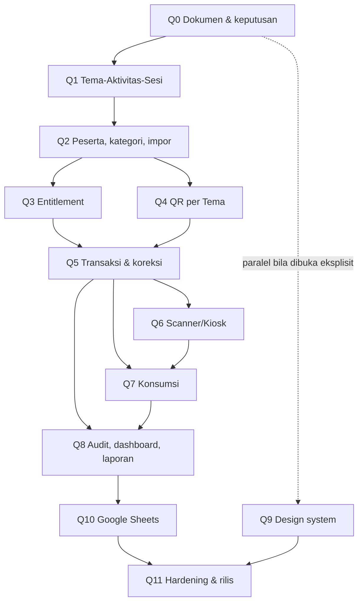

# IMPLEMENTATION ROADMAP — QRCek

> **Status:** Draft v1 — Pending Product Owner Review. Dibuat 3 November 2026 dari [`REQUIREMENTS.md`](./REQUIREMENTS.md) v0.3.1.
> **Baseline:** commit `157c330` (`REQUIREMENTS.md` §7). Riwayat Fase 0–6 ada di [`../IMPLEMENTATION_PLAN.md`](../IMPLEMENTATION_PLAN.md) (arsip, `D-002` [A]).
> **Sifat dokumen:** urutan tahap, prasyarat keputusan, dan gate. Dokumen ini **merujuk** `FR-`/`BR-`/`AC-` dan tidak menyalin isinya. Rencana eksekusi teknis per tahap ditulis di `.opencode/plans/` setelah tahapnya dibuka.

---

## 1. Aturan roadmap

1. **Tahap dibuka oleh pemilik proyek**, bukan oleh agent. Status "Belum dibuka" berarti tidak ada kode fitur untuk tahap itu.
2. **Gate keras.** Tahap berikutnya tidak dimulai sebelum gate tahap sebelumnya terpenuhi dan dibuktikan dengan perintah yang bisa dijalankan ulang, lalu direview manusia (`REQUIREMENTS.md` §14 #10).
3. **Prasyarat keputusan wajib.** Requirement bertanda `[P]` tidak dikerjakan sebagai final sebelum keputusan terkait disetujui; `[O]` tidak boleh dijawab sendiri; AQ dijawab lewat ADR sebelum tahapnya dibuka (lihat [`DECISIONS.md`](./DECISIONS.md)).
4. **Repo tetap hijau** di setiap commit: `npm run typecheck` → `npm run lint` → `npm run test` (dan `npm run build` sebelum menutup tahap).
5. **Reuse sebelum menulis ulang** (`FR-172`, `FR-173`). Setiap tahap mencantumkan modul baseline yang dievaluasi.
6. **Regression test wajib** untuk fitur baseline yang dipakai ulang atau diganti (`D-007` [A], `FR-175`).
7. **Ukur, jangan tebak.** Klaim CPU, jumlah statement, atau baris dibaca/ditulis harus punya angka.
8. **Tidak ada fitur "sekalian".** Ide di tengah tahap dicatat sebagai usulan, bukan dikerjakan.
9. **Dokumen diperbarui di perubahan yang sama** (`AC-038`): `DESAIN_API.md`, `DESAIN_DATABASE.md`, `RENCANA_PENGUJIAN.md`, `ARCHITECTURE.md`, dan baris status di dokumen ini.

### Definisi selesai sebuah tahap

- Semua acceptance criteria tahap terpenuhi dengan bukti (tes atau langkah manual tercatat).
- Tes integritas tahap ada dan **gagal bila aturannya dihapus** (`NFR-018`, `AC-035`).
- `typecheck` → `lint` → `test` → `build` hijau; CI hijau.
- Dokumen terkait diperbarui; tidak ada klaim "selesai" hanya karena endpoint tersedia (`FR-178`).
- Tidak ada dependensi baru tanpa justifikasi satu baris (`NFR-020`).
- Pemilik proyek menyetujui ringkasan tahap.

---

## 2. Ringkasan tahap

| Tahap | Fokus | Status | Prasyarat keputusan utama |
|---|---|---|---|
| Q0 | Penyelarasan dokumen & keputusan | **Berjalan** | `D-001`, `D-002` [A] |
| Q1 | Fondasi Tema → Aktivitas → Sesi, lifecycle, mekanisme audit | **Selesai (API-only)** | AQ-001, AQ-010, AQ-014 (ADR-0009–0011, Diterima); ADR-0012 (lifecycle), ADR-0013 (registrasi), keduanya Diterima; `D-009`, `D-010`, `D-023` [A]; `OQ-033` [A] untuk aksi arsip Sesi |
| Q2 | Peserta, kategori, custom field, impor CSV | **Selesai (API-only) — kode + migrasi `0008` live 8 November 2026** | AQ-006 dijawab ADR-0014 (Diterima 6 November 2026); `D-008`, `D-020` [A] |
| Q3 | Entitlement | **Selesai (API-only) — kode + migrasi `0009` live 8 November 2026, gate ditutup 9 November 2026** | AQ-005 dijawab ADR-0016 (Diterima 8 November 2026) |
| Q4 | QR Identity per Tema, rotasi, ekspor PNG/ZIP | **Ditutup 9 November 2026 (API-only)**; smoke sesi produksi menunggu pemilik, AC-018 (PNG/ZIP) tetap Q9 | AQ-009 dijawab ADR-0017 (Diterima 9 November 2026); `D-016` [A] |
| Q5 | Transaksi Attendance, Manual Entry, Reversal/Adjustment | **Selesai (API-only) — kode live + smoke produksi 14 November 2026, gate ditutup**; Manual Entry belum diuji (UI/penugasan di Q6) | AQ-002–AQ-004, AQ-007, AQ-008 dijawab ADR-0018–0022 (Diterima 9 November 2026); `D-010`, `D-011`, `D-022`, `D-024` [A]; `OQ-034` [A] |
| Q6 | Penugasan Petugas & Scanner/Kiosk | Belum dibuka | AQ-007, AQ-008, AQ-012; `D-012`, `D-013` [A] |
| Q7 | Distribusi konsumsi | Belum dibuka | AQ-002, AQ-003; `D-009`, `D-014` [A] |
| Q8 | Audit lengkap, dashboard, navigasi, laporan & ekspor | Belum dibuka | AQ-013, AQ-014; `D-015`, `D-023` [A] |
| Q9 | Design system & UI | Belum dibuka | `D-021` [A] |
| Q10 | Google Sheets opsional | Belum dibuka | AQ-011; `D-017` [A] |
| Q11 | Hardening, verifikasi lapangan, rilis | Belum dibuka | `D-019` [A] dikonfirmasi |

Alasan urutan: transaksi (Q5) membutuhkan konteks (Q1), peserta (Q2), entitlement (Q3), dan QR per Tema (Q4). Scanner (Q6) didahulukan dari konsumsi (Q7) agar alur Attendance end-to-end bisa diuji di lapangan lebih awal. Sheets (Q10) terakhir karena proyeksinya bergantung bentuk akhir transaksi.

---

## 3. Persyaratan lintas tahap

Berlaku untuk setiap tahap; tidak diulang di tiap bagian.

| Aspek | Rujukan |
|---|---|
| Otorisasi di Worker pada setiap route; guard React hanya UX | `NFR-001`, `FR-169`, `AGENTS.md` |
| Validasi input di boundary dengan skema `packages/shared` | `AGENTS.md` |
| Tanpa PII/token/secret di log dan audit | `NFR-006`, `FR-195` |
| Waktu UTC, konversi di presentasi | `NFR-013` |
| Reuse dievaluasi; struktur tak kompatibel boleh diganti | `FR-172`–`FR-175`, `FR-198`, `D-007` [A] |
| Identifier teknis `absensi` dipertahankan; nama produk QRCek | `FR-196`, `D-019` [A] |
| Status implementasi dipisah dari kebutuhan | `FR-177`, `FR-178` |
| Free tier saja; anggaran CPU/query/baris diperhitungkan | `NFR-009`–`NFR-012` |

---

## 4. Detail tahap

### Q0 — Penyelarasan dokumen dan keputusan

**Status:** Berjalan (dokumentasi dikerjakan 3 November 2026).

**Cakupan:** `FR-176`–`FR-181`; `D-001`, `D-002` [A].

**Hasil:**

- [x] `docs/ARSITEKTUR.md` dipindah menjadi `docs/ARCHITECTURE.md` dan diselaraskan dengan model target.
- [x] ADR-001…008 diekstrak ke `docs/adr/0001`–`0008`.
- [x] `docs/DECISIONS.md` (indeks keputusan + AQ) dan dokumen ini dibuat.
- [x] `AGENTS.md`, `README.md`, dokumen teknis, dan konfigurasi `.opencode/` diselaraskan.
- [x] `IMPLEMENTATION_PLAN.md` ditandai arsip; `PLAN_TAB_PESERTA.md` dievaluasi (§5).

**Gate untuk membuka Q1:**

- [x] Product owner mereview `REQUIREMENTS.md` v0.3.1 dan dokumen turunan ini.
- [x] Keputusan Q1 disetujui: `D-009`, `D-018`, `D-023` (semua `[A]`).
- [x] ADR untuk AQ-001, AQ-010, AQ-014 berstatus Diterima.
- [x] ADR-0012 (tabel transisi lifecycle) dan ADR-0013 (pendaftaran mandiri nonaktif) berstatus Diterima.
- [x] `REQUIREMENTS.md` §0.3 dan §13.3 diperbarui product owner agar status dokumen turunan tidak lagi "belum dibuat".

---

### Q1 — Fondasi Tema → Aktivitas → Sesi

**Tujuan:** sistem dapat merepresentasikan Tema dengan banyak Aktivitas dan Sesi beserta lifecycle-nya, dengan audit yang sudah memakai mekanisme final.

**Cakupan:**

- Hierarki dan konteks: `FR-001`, `FR-002`, `FR-005`–`FR-012`, `FR-182` (`D-009` [A]); `BR-001`, `BR-003`–`BR-009`, `BR-070`.
- Lifecycle: `FR-090`–`FR-096`, `FR-206`; `BR-047`–`BR-049`, `BR-078`. Aksi pengarsipan Sesi diatur `OQ-033` [A]; state arsip dan penolakan transaksinya boleh disiapkan.
- Akses per Tema: `FR-097`, `FR-098`. Bila `D-018` disetujui: `FR-194`.
- Audit mutasi Tema/Aktivitas/Sesi memakai allowlist (`FR-135` sebagian, `FR-207`; AQ-014).

**Reuse yang dievaluasi:** `routes/events.ts`, `packages/shared/src/events.ts` (tabel transisi), `domain/permissions.ts`, `db/events.ts`, undangan & keanggotaan, `lib/navigation.ts`, `lib/router.ts`.

**Gate:**

- `AC-001`, `AC-004` (struktural), `AC-005`.
- Tes: Sesi tidak bisa dibuat di bawah Aktivitas Tema lain; transisi status Aktivitas/Sesi sah/terlarang (tabel lengkap, murni); duplikasi Sesi menyalin konfigurasi saja dengan status awal Terjadwal (`BR-048`); akses lintas Tema → 404.
- Regression: tes auth, undangan, dan isolasi acara baseline tetap lulus atau diganti tes setara.
- `DESAIN_DATABASE.md` mencatat migrasi baru; tidak ada migrasi lama yang diedit.

**Bukan cakupan:** transaksi, entitlement, scanner.

**Hasil implementasi (4 November 2026 — menunggu review manusia):**

- `migrations/0007_q1_activities_sessions.sql` menambah `activities` dan `activity_sessions`; `0001`–`0006` tidak diedit.
- Route API: `/api/events/:eventId/activities` dan `/api/events/:eventId/activities/:activityId/sessions` beserta status/arsip/duplikasi; alias `/api/themes` dan `/api/calendar` memakai handler yang sama.
- Lifecycle di `packages/shared/src/lifecycle.ts` (ADR-0012); audit allowlist di `packages/shared/src/audit-allowlist.ts` (ADR-0011).
- Tes: `packages/shared/src/lifecycle.test.ts`, `audit-allowlist.test.ts`, `apps/api/src/test/activities.api.test.ts`, `activity-sessions.api.test.ts`, `themes-alias.test.ts`, `register.closed.test.ts`.
- **Penguatan 5 November 2026:** uji mutasi pada tiga guard inti menemukan satu celah (audit bisa tertulis walau mutasi gagal); ditutup oleh `apps/api/src/test/audit.guarded-write.test.ts`. Daftar Aktivitas/Sesi diputuskan tanpa paginasi pada Q1 (additive nanti) — lihat `DESAIN_API.md` §6. Rincian penyimpangan rencana ada di `.opencode/plans/q1-tema-aktivitas-sesi.md` §16.
- **Ditunda:** UI Aktivitas/Sesi (Q6/Q8/Q9), shim "satu Aktivitas default" untuk Tema lama (Q5), dan seluruh perilaku transaksi (`AC-004` bagian transaksi, `AC-005` bagian riwayat transaksi).
- Gate di atas **ditutup 6 November 2026**: pemilik proyek menyetujui hasil Q1, `REQUIREMENTS.md` §0.3/§13.3 diperbarui (v0.3.3), dan migrasi `0007` diterapkan di remote sebelum kode masuk `main`. Sisa cakupan (UI, transaksi, shim Aktivitas default) tetap menjadi pekerjaan tahap lanjut seperti tercantum di atas.

---

### Q2 — Peserta, kategori, custom field, impor CSV

**Tujuan:** peserta terdaftar di Tema dengan kategori sebagai entitas, custom field yang aman dari kehilangan data, dan impor yang tidak pernah mengubah data tanpa persetujuan admin.

**Cakupan:**

- Peserta: `FR-003`, `FR-013`–`FR-025`; `BR-010`–`BR-012`.
- Custom field: `FR-026`–`FR-033`; `BR-013`–`BR-017`.
- Kategori: `FR-034`–`FR-036`.
- Impor: `FR-046`–`FR-053`, `FR-197`, `FR-205` (`D-008`, `D-020` [A]); `BR-061`–`BR-063`, `BR-076`, `BR-077`.

**Reuse yang dievaluasi:** `domain/csv.ts` (parser RFC 4180, 31+ kasus tes), `domain/participant-import.ts`, `routes/participants.ts`, normalisasi telepon/email, soft-delete `inactive`, `pages/import.tsx`, `pages/event-participants.tsx`. Masukan dari `PLAN_TAB_PESERTA.md`: lihat §5.

**Gate:**

- `AC-006`–`AC-010`, `AC-042`, `AC-054`.
- Tes: Participant ID tidak bisa diubah lewat API; impor tanpa konfirmasi tidak menulis; External Reference cocok banyak kandidat → tidak ada pemilihan otomatis; nama/email/phone sama → warning, bukan merge; field kosong tidak menghapus nilai; rename/nonaktif/arsip custom field tidak menghapus nilai; perubahan tipe tidak kompatibel ditolak.
- Batas 2 MB / 1.000 baris menghasilkan pesan actionable (`FR-197`).

**Bukan cakupan:** entitlement per kategori (Q3).

**Prasyarat keputusan:** AQ-006 dijawab ADR-0014 (Diterima 6 November 2026). Tahap **dibuka 6 November 2026** oleh pemilik proyek setelah gate Q1 direview; rencana eksekusi ada di `.opencode/plans/q2-peserta-kategori-impor.md`.

**Hasil implementasi (7 November 2026, API-only):**

- Migrasi `0008_q2_categories_custom_fields.sql`: tabel `categories` dan `custom_fields`, kolom `participants.category_id` + `participants.attributes_json`, backfill kategori dari teks lama, dan trigger yang menegakkan `category_id` wajib + satu Tema + mirror `participants.category`. `0001`–`0007` tidak disentuh.
- Route: `/api/events/:eventId/categories` (list/create/detail/patch/status), `/api/events/:eventId/custom-fields` (list/create/detail/patch/status/type), dan kontrak peserta baru (`categoryId` wajib, `attributes` tervalidasi tipe) beserta impor CSV yang mewajibkan header + nilai `category`. Semua route otomatis mendapat alias `/api/calendar` dan `/api/themes`.
- Aturan murni di `packages/shared/src/participant-attributes.ts` (validasi tipe, merge parsial, ubah tipe, koersi CSV) dan skema di `packages/shared/src/schemas/{categories,custom-fields,participants}.ts`.
- Audit `category.*`, `custom_field.*`, dan `participant.*` ditulis dalam `db.batch()` yang sama; snapshot hanya memuat field allowlist, daftar key atribut yang berubah, dan tidak pernah nilai atribut/PII/`options_json`.
- Batas 50 field aktif dan 100 opsi ditegakkan di Worker sebagai `422 BUSINESS_RULE`; arsip membebaskan slot.
- Tes baru: `packages/shared/src/participant-attributes.test.ts`, `apps/api/src/test/categories.api.test.ts`, `custom-fields.api.test.ts`, `participant-attributes.api.test.ts`, perluasan `audit.guarded-write.test.ts` dan tes impor/peserta. Uji mutasi enam guard inti tertangkap (`RENCANA_PENGUJIAN.md` §9.2).
- **Penyimpangan kompatibilitas:** `participants.category` (teks) tetap ada sebagai mirror yang dijaga trigger; create/update satu peserta masih menerima nama `category` sebagai input deprecated, sedangkan impor CSV **tidak** membuat kategori otomatis (ADR-0014). `PATCH` peserta tidak dapat menghapus kategori (`category: null` diabaikan), sehingga kategori wajib selalu terpenuhi.
- **Belum:** UI kategori/custom field/atribut (Q9) dan nilai custom field per Aktivitas/Sesi (Q3).
- **Gate ditutup 8 November 2026:** PR #1 di-merge ke `main` (`2a0eeba`), Workers Builds hijau, `0008` diterapkan ke remote (`schema_version = 8`), dan verifikasi produksi bersih: 80 peserta, 32 kategori, 0 peserta tanpa kategori, 0 kategori lintas Tema, 0 `attributes_json` invalid, 6 trigger ada. Route Q2 merespons `401` tanpa sesi (bukan `404`). Rincian di `docs/OPERASIONAL.md` §"Status operasi saat ini".
- **Pelajaran rilis:** build Workers Builds selesai sebelum migrasi diterapkan (jendela ~14 menit) karena export backup gagal akibat token Wrangler kedaluwarsa. Data akhir bersih, tetapi rilis yang mengubah kontrak berikutnya harus memakai expand/contract atau mematikan auto-deploy sementara. Form peserta di web kini menandai kategori wajib agar tidak menabrak validasi API.

---

### Q3 — Entitlement

**Tujuan:** hak akses peserta per Aktivitas/Sesi dapat dikonfigurasi dan di-resolve deterministik.

**Cakupan:** `FR-037`–`FR-042`, `FR-199`; resolver untuk `FR-043`/`FR-044`; `BR-018`–`BR-023`, `BR-075`.

**Prasyarat tambahan:** AQ-005 sudah dijawab **ADR-0016 (Diterima 8 November 2026)**: satu tabel `entitlement_rules`, resolver murni, default deny, gate `draft → active`, baris eksplisit per kategori aktif, kategori baru fail-closed, backfill `allowed`, dan Theme default hanya sebagai fallback. Tahap **dibuka 8 November 2026**; rencana eksekusi ada di `.opencode/plans/q3-entitlement.md`.

**Gate:**

- `AC-011`, `AC-012`, `AC-014`, `AC-043`.
- Tes tabel resolver mencakup lima tingkat × Inherit/Allowed/Denied, override Sesi hanya untuk Sesi itu, perubahan kategori tidak menghapus override individual. Resolver murni, tanpa I/O.
- `FR-040`/`FR-041`: `draft → active` ditolak `422 BUSINESS_RULE` saat matriks belum lengkap; lolos setelah setiap kategori aktif punya baris; kategori baru membuat `entitlementComplete = false` dan di-deny sampai dikonfigurasi.
- Migrasi `0009` additive, `schema_version = 9`, backfill `allowed` untuk Aktivitas × kategori lama, dan jumlah baris backfill dicatat.
- Jumlah query untuk me-resolve satu peserta dalam satu konteks terukur dan dicatat.

**Bukan cakupan:** penolakan di endpoint scan (Q5) dan tampilan scanner (`FR-045`, Q6).

**Hasil implementasi (8 November 2026, API-only):**

- Migrasi `0009_entitlement_rules.sql`: tabel `entitlement_rules`, lima partial unique index `uq_ent_*`, dua trigger konteks, backfill `allowed` untuk Aktivitas `active` × kategori (termasuk kategori arsip berpeserta), `schema_version = 9`.
- Resolver murni di `packages/shared/src/entitlements.ts` (lima tingkat prioritas, `inherit`, default deny, helper kelengkupan); kategori baru pada Aktivitas `active` membuat `entitlementComplete = false` tanpa menonaktifkan Aktivitas.
- Route: `/api/events/:eventId/entitlements/default`, `/api/events/:eventId/activities/:activityId/entitlements` (matriks + batch kategori), `.../entitlements/categories`, `.../entitlements/participants/:participantId`, `.../entitlements/sessions/:sessionId/...`, dan `.../entitlements/resolve` (preview). Semua otomatis mendapat alias `/api/calendar` dan `/api/themes`.
- Otorisasi: `entitlement:read` (`officer`) untuk membaca, `entitlement:write` (`event_admin`) untuk menulis; Super Admin lolos lewat aturan global.
- Audit: action `entitlement_rule.*`, snapshot hanya ID + `status`, dalam `db.batch()` yang sama dengan mutasi; mutasi gagal tidak menulis audit.
- Gate `draft → active`: `422 BUSINESS_RULE` saat kategori aktif belum punya baris; `POST` tetap membuat `draft` tanpa konfigurasi otomatis (`FR-040`/`FR-041`).
- Ukuran: resolver **1 statement, ≤5 baris**, query plan 5/5 `SEARCH` (dengan Sesi), 3/3 tanpa Sesi, 0 `SCAN`; batch kategori **15 baris** (≤50 statement/invokasi D1).
- **Rilis 8 November 2026:** deploy Workers Builds `dc8b8546-9a40-46f9-96af-e047987b553e` (04:26 UTC) sukses; migrasi `0009` diterapkan ke remote (`app_meta.schema_version = 9`, tabel + 5 `uq_ent_*` + 2 `trg_ent_*` terverifikasi); kandidat backfill produksi **0 baris** (tabel `activities` kosong); `GET /api/health/ready` → `200 (database: ok)`.
- **Gate ditutup 9 November 2026:** `AC-011`, `AC-012`, `AC-014` lulus di tes (resolver murni 16 tes, DB/backfill 14 tes, API/otorisasi/gate 19 tes); `AC-043` tingkat transaksi menunggu Q5 karena Q3 tidak menulis transaksi apa pun. Verifikasi akhir `typecheck` → `lint` → `test` (637 tes / 60 file) → `build` hijau. Tidak ada UI Q3.
- **Ditunda eksplisit:** penolakan transaksi `NOT_ENTITLED` (Q5) dan nilai custom field `scope='activity'` (`FR-033`, Q5; disetujui pemilik 8 November 2026).

---

### Q4 — QR Identity per Tema, rotasi, ekspor PNG/ZIP

**Tujuan:** satu QR per Tema + Peserta, dapat dirotasi, dan dapat diunduh sebagai PNG/ZIP tanpa membebani Worker.

**Cakupan:** `FR-004`, `FR-054`–`FR-065`, `FR-200`; `BR-002`, `BR-024`–`BR-029`.

**Reuse yang dievaluasi:** `domain/qr-token.ts` (ADR-0003, ADR-0006), `routes/labels.ts`, `components/qr-code.tsx`, `lib/qr-labels.ts`. Cetak label A4/stiker via `window.print()` tidak diminta `REQUIREMENTS.md` dan bukan generator PDF; mempertahankan atau memensiunkannya diputuskan pemilik proyek saat tahap dibuka.

**Prasyarat keputusan:** AQ-009 dijawab **ADR-0017 (Diterima 9 November 2026)**: satu tabel `qr_identities` dengan satu baris aktif per `(theme_id, participant_id)`, penerbitan lazy saat cetak/unduh pertama, rotasi in-place dengan alasan wajib, riwayat rotasi di audit, backfill kredensial lama, dan QR peserta nonaktif ditolak saat scan. Tahap **dibuka 9 November 2026** (API-only); rencana eksekusi ada di `.opencode/plans/q4-qr-identity.md`. UI ekspor final masuk Q9; Q4 menyediakan backend, payload, dan batas batch.

**Gate:**

- `AC-015`–`AC-018`.
- Tes: token Tema A ditolak di konteks Tema B; rotasi → token lama langsung ditolak, riwayat transaksi tidak berubah, audit tercatat tanpa token; QR peserta nonaktif ditolak; permintaan data token tanpa izin → 403/404; ekspor tercatat di audit dengan jumlah, bukan token.
- Batas batch per request ditetapkan dari pengukuran CPU (baseline 50).

**Status rilis 9 November 2026 (API-only):**

- Commit `ad02903` di-push ke `main`; Workers Builds **success**. Migrasi `0010_qr_identities.sql` diterapkan ke remote (backup pra-migrasi 149 KB), `app_meta.schema_version = 10`, **60 baris** `qr_identities` dari 60 kandidat legacy, 2 index unik + 2 trigger, `mismatched = 0`, `GET /api/health/ready` → `200`.
- `AC-015`/`AC-017` dibuktikan di level keputusan murni, database, dan HTTP scan baseline. Jalur scan target berkonteks Aktivitas/Sesi tetap **deferral Q5**.
- `AC-016` dibuktikan: rotasi in-place, token lama `not_found`, riwayat `attendance` tidak berubah, audit `qr.identity_rotated` tanpa kredensial, rotasi paralel satu `200`/satu `409`, dan mirror kredensial ke `participants.qr_*` agar rollback Worker tidak menghidupkan token lama. Retry dengan `expectedRotationCount` basi → `409`.
- `AC-018` **sebagian**: otorisasi, payload, batas batch, dan audit jumlah terbukti; rendering PNG/ZIP dan tombol unduh tetap Q9.
- Batas batch diturunkan ke **38** setelah pengukuran: halaman 38 label = 47 statement D1 (batas 50), reprint 8, jalur lost-race 48. Angka di [`OPERASIONAL.md`](./OPERASIONAL.md) §6.2.
- Penyimpangan dari rencana: audit penerbitan lazy satu baris per request berisi `count`, bukan per peserta, agar tetap di bawah 50 statement. Dicatat di `.opencode/plans/q4-qr-identity.md` §16.
- **Gate Q4 ditutup 9 November 2026** dengan persetujuan pemilik untuk urutan rilis, setelah review keamanan independen (0 blocker; 2 major diperbaiki: mirror legacy saat rotasi dan urutan migrasi-dulu). **Belum dijalankan:** smoke dengan sesi produksi (cetak → scan → rotasi → token lama ditolak); pemilik perlu menjalankannya. AC-018 tetap Q9.

---

### Q5 — Transaksi Attendance, Manual Entry, Reversal/Adjustment

**Tujuan:** model transaksi target menggantikan `attendance` baseline: konteks Aktivitas/Sesi, duplikasi berbasis transaksi efektif di database, koreksi non-destruktif.

**Status:** **dibuka 9 November 2026 (API-only)** oleh pemilik proyek. Lima ADR diterima pada tanggal yang sama: [ADR-0018](./adr/0018-transaction-table-shape.md) (AQ-002), [ADR-0019](./adr/0019-effective-transaction-constraints.md) (AQ-003), [ADR-0020](./adr/0020-reversal-adjustment-structure.md) (AQ-004), [ADR-0021](./adr/0021-staff-assignments-and-permissions.md) (AQ-007), [ADR-0022](./adr/0022-scan-result-contract.md) (AQ-008). Butir terbuka ADR-0021 diputuskan: Super Admin **tidak** boleh QR scan transaksional. Rencana eksekusi ada di [`.opencode/plans/q5-transactions.md`](../.opencode/plans/q5-transactions.md).

**Status implementasi 12 November 2026:** API-only selesai dan terverifikasi lokal — migrasi `0011`, kontrak shared, route scan/Manual Entry/Reversal/Adjustment, adaptor baca legacy, dan tes. `typecheck`, `lint`, `test` (**702 tes / 68 file**), dan `build` PASS; pengukuran statement scan 15, Reversal 11, Manual Entry 13, Adjustment 12. Migrasi `0011` **sudah diterapkan di remote** (`schema_version = 11`, backup pre-0011 187 KB, 12 Aktivitas default, 26 transaksi hasil backfill, 5 penugasan, 32 aturan entitlement, 0 lintas Tema). Gate Q5 **ditutup 14 November 2026** setelah kode live dan smoke produksi — lihat paragraf berikutnya.

**Status implementasi 14 November 2026 — gate Q5 ditutup (API-only).** Kode Q5 di-push sebagai commit `4e9e7cb` dan live di produksi lewat Workers Builds (deployment `a20ecebb`, 12 November 2026 06:31 UTC). Smoke dengan sesi produksi nyata di Tema `percobaan`: scan Petugas → `SUCCESS`, scan ulang → `DUPLICATE`; Adjustment oleh Admin Acara membuat transaksi pengganti tanpa menimpa aslinya (`01M7BW5H…` → `01M7BW88…`); Reversal atas transaksi pengganti membebaskan slot; scan berikutnya → `SUCCESS` (`01M7BWDB…`). `attendance` tetap **26** baris, `transactions` 26 → **29**, transaksi efektif 26 → **27**, `transaction_corrections` 0 → **2**, dan audit mencatat `transaction.recorded` ×2, `transaction.adjustment`, `transaction.reversal`. Super Admin ditolak untuk scan maupun koreksi. Manual Entry belum diuji: `allow_manual = 0` dan UI penugasan baru ada di Q6. Setelah smoke, `SESSION_PEPPER` dirotasi (10 sesi lama di-revoke, 22 recovery code lama tidak berlaku) dan QR peserta uji dirotasi. Seluruh bukti dan ID ada di `docs/RENCANA_PENGUJIAN.md` §9.5 dan `docs/OPERASIONAL.md` §6.4.

**Prasyarat keputusan:** AQ-002/AQ-003/AQ-004/AQ-007/AQ-008 **dijawab** ADR-0018–0022 (Diterima 9 November 2026). Arahan pemilik yang mengikat: (1) migrasi Q5 membuat **satu Aktivitas default** per Tema tanpa Aktivitas lalu mem-backfill `attendance` lama; (2) **adaptasi web minimal** ikut Q5 agar scan/koreksi tetap berfungsi, scanner/kiosk penuh tetap Q6. Teks `REQUIREMENTS.md` yang masih menulis "belum ditetapkan" untuk izin Manual Check-in Super Admin (`FR-073`, `BR-034`, `AC-021`, `AC-049`, `AC-055`) tidak mengubah keputusan `OQ-034` [A] ("tidak"); penyuntingan teks itu dilakukan pemilik karena `REQUIREMENTS.md` bukan milik agent.

**Cakupan:**

- Transaksi: `FR-066`–`FR-072`, `FR-075`, `FR-088`, `FR-162`–`FR-167`, `FR-169`; penegakan `FR-043`/`FR-044` dan `FR-183`–`FR-188`; `BR-030`–`BR-033`, `BR-035`, `BR-064`–`BR-066`, `BR-071`, `BR-072`.
- Manual Entry: `FR-073`, `FR-074` (`D-022` [A], `OQ-034` [A]); `BR-034`.
- Koreksi: `FR-076`–`FR-080`, `FR-201`, `FR-202`, `FR-106`; `BR-036`–`BR-040`.
- Pesan duplikat Attendance: `FR-203` (bagian Attendance).

**Perubahan baseline yang wajib:**

- Jalur `POST .../attendance/:id/correction` yang melakukan `UPDATE attendance` diganti Reversal/Adjustment (`D-006` [A]).
- Kewenangan koreksi Super Admin tidak diperluas maupun dihapus diam-diam; ikuti keputusan `D-024`.
- Izin legacy `attendance:correct` tidak dipakai sebagai izin Manual Check-in (`AC-055`).
- `UNIQUE (event_id, participant_id)` baru dilepas setelah constraint pengganti ada dan tes konkurennya lulus.

**Gate:**

- `AC-002`, `AC-003`, `AC-013`, `AC-019`–`AC-023`, `AC-035`, `AC-040`, `AC-041`, `AC-044`, `AC-045`, `AC-049`, `AC-055`.
- Tes integritas wajib (`RENCANA_PENGUJIAN.md` §9): scan ganda ruang lingkup sama; dua scan paralel → tepat satu sukses (diulang ≥ 50 kali tanpa flakiness); Sesi berbeda diterima; konteks lintas Tema/Aktivitas/Sesi ditolak tanpa menulis; lifecycle tertutup ditolak; Petugas → koreksi 403; Reversal membebaskan slot; Adjustment menyimpan before/after field allowlist; koreksi + audit dalam satu batch.
- Jumlah statement D1 per scan dihitung dari kode dan dicatat.

---

### Q6 — Penugasan Petugas dan Scanner/Kiosk

**Tujuan:** Petugas memindai di HP/kiosk dalam konteks yang ditugaskan, dengan feedback jelas dan tanpa keberhasilan palsu.

**Cakupan:**

- Penugasan & peran: `FR-099`–`FR-105`; `BR-050`–`BR-053`.
- Scanner: `FR-045`, `FR-107`–`FR-128`, `FR-189`–`FR-192` (`D-012`, `D-013` [A]); `BR-054`–`BR-057`; `NFR-014`, `NFR-015`, `NFR-022`.

**Reuse yang dievaluasi:** `components/qr-scanner.tsx`, `lib/scanner.ts`, `components/scan-toast.tsx`, `StaffScanPage` di `pages/staff.tsx` (baseline: sudah memanggil endpoint scan per acara), `lib/attendance.ts` (`scanQr`). `pages/staff-scan.tsx` adalah kode mati (tidak diimpor); kandidat dihapus saat Q6 dengan persetujuan.

**Gate:**

- `AC-026`–`AC-028`, `AC-048`, `AC-053`.
- Tes: Petugas tanpa penugasan pada Aktivitas/Sesi → ditolak backend walau URL memilih konteks itu; kesalahan jaringan dibedakan dari QR tidak valid; tidak ada antrean offline.
- **Uji perangkat fisik** (dicatat di `OPERASIONAL.md`): iPhone (fallback ZXing) dan Android (`BarcodeDetector`) masing-masing 20 scan berturut tanpa reload; kamera depan/belakang; portrait/landscape; jaringan dimatikan menampilkan pesan actionable.

---

### Q7 — Distribusi konsumsi

**Tujuan:** penukaran konsumsi sebagai transaksi independen dengan kuota.

**Cakupan:** `FR-081`–`FR-087`, `FR-089`, `FR-203` (bagian Consumption), state Consumption di `FR-119`; `BR-041`–`BR-046`, `BR-073`.

**Gate:**

- `AC-024`, `AC-025`, `AC-046`.
- Tes: penukaran melebihi kuota efektif ditolak di database (termasuk paralel); kuota 0 menolak; Reversal mengembalikan kuota (hanya bila `D-014` disetujui); perubahan entitlement tidak menghapus riwayat penukaran.

**Bukan cakupan:** inventory/stock management (`D-014` [A]).

---

### Q8 — Audit lengkap, dashboard, navigasi, laporan & ekspor

**Cakupan:**

- Audit: `FR-135`–`FR-140`, `FR-170`, `FR-195`, `FR-207`; `BR-058`, `BR-074`, `BR-079`; `NFR-023`.
- Dashboard & navigasi: `FR-129`–`FR-134`.
- Laporan & ekspor: `FR-141`–`FR-149` (`D-015` [A]); `BR-059`, `BR-060`.

**Reuse yang dievaluasi:** `routes/audit.ts`, `db/audit.ts`, `routes/dashboard.ts`, ekspor CSV kehadiran/peserta, `pages/activity.tsx`, `pages/event-reports.tsx`, `lib/navigation.ts`.

**Gate:**

- `AC-029`–`AC-033`, `AC-047`.
- Tes: setiap endpoint mutasi menghasilkan ≥ 1 baris audit (tes iterasi tabel route); audit tidak memuat token/secret dan nilai field sensitif; Petugas ditolak membaca audit; ekspor sesuai filter dan tercatat di audit.
- Query dashboard/laporan memakai indeks (`EXPLAIN QUERY PLAN` → `SEARCH`) dan baris dibaca terukur.

---

### Q9 — Design system dan UI

**Catatan pembukaan:** boleh dibuka paralel setelah Q0 hanya bila pemilik proyek menyetujui `D-021` dan membukanya secara eksplisit. Tahap ini tidak boleh mengubah perilaku atau kontrak API.

**Cakupan:** `FR-150`–`FR-161`, `FR-204`; `NFR-016`, `NFR-021`, `NFR-022`.

**Reuse yang dievaluasi:** `apps/web/src/index.css` (token shadcn/ui), `components/ui/`, komponen layout/sidebar/tabs yang sudah ada.

**Gate:** `AC-039`, `AC-053`; checklist visual manual (light/dark, kontras AA, reduced motion, layar kecil) tercatat; tidak ada runtime CDN.

---

### Q10 — Google Sheets opsional

**Cakupan:** `FR-193` (`D-017` [A]); proyeksi baru sesuai ADR dari AQ-011.

**Reuse yang dievaluasi:** `services/outbox.ts`, `domain/sheets.ts`, `domain/sheet-projection.ts`, `domain/outbox-policy.ts`, `routes/sync.ts` (ADR-0004, ADR-0005).

**Gate:** `AC-051`; tes dengan fake Sheets client (batching, idempotensi retry, error permanen → `dead`, kegagalan sync tidak memblokir transaksi); uji dengan akun Google nyata tercatat sebelum diklaim production-ready.

---

### Q11 — Hardening, verifikasi lapangan, rilis

**Cakupan:** verifikasi seluruh `NFR-001`–`NFR-023`; `AC-034`, `AC-036`, `AC-037`, `AC-052`.

**Pekerjaan:** pengukuran CPU produksi (`wrangler tail`), smoke test produksi end-to-end, backup `wrangler d1 export` sebelum migrasi remote, prosedur break-glass diuji, kebijakan retensi audit final (`D-023`), pembaruan `COSTS_AND_LIMITS.md` dengan model transaksi baru, CI hijau tercatat.

**Gate:** semua butir di atas tercatat di `OPERASIONAL.md` dengan tanggal dan hasil.

---

## 5. Evaluasi `PLAN_TAB_PESERTA.md` (`D-002` [A])

| Bagian rencana lama | Keputusan integrasi | Alasan |
|---|---|---|
| R1–R3, R5, R6: tabel peserta, sort per kolom, empty state, QR tidak di tabel, detail drawer | Dibawa ke **Q2** sebagai masukan UX | Tidak bertentangan dengan `REQUIREMENTS.md`; `FR-159` (baris tabel bukan card) selaras |
| D3: pemetaan kolom CSV | Dibawa ke **Q2** | Selaras `FR-047`; harus ditambah review duplikat Skip/Update dan konfirmasi (`D-008` [A]) |
| D1/D2: katalog field + `attributes_json`, kategori sebagai kolom builtin teks | **Masukan AQ-006 saja** | Katalog "hanya bertambah" dan nilai teks saja belum memenuhi `FR-027`–`FR-032`; kategori harus entitas (`FR-034`) |
| D4: sort/filter di klien dengan cap baris | Masukan **Q2** | Valid untuk anggaran D1; cap harus diukur |
| D5: penerbitan QR digerakkan klien per 50 | Dibawa ke **Q4** | Selaras batas CPU dan `D-016` [A] |
| D6/D8: PNG/ZIP dirakit di browser tanpa dependensi | Dibawa ke **Q4** | Selaras `D-016` [A] dan `NFR-020` |
| R7/D8: unduh QR sebagai **PDF** | **Tidak dibawa** | Bertentangan dengan `NG-04`/`NG-05` |
| Upsert otomatis saat impor | **Tidak dibawa** | Bertentangan dengan `FR-050`, `BR-061` |
| Migrasi `0007_participant_fields.sql` dengan backfill | **Tidak dibawa apa adanya** | Skema ditentukan AQ-006/AQ-010; backfill data produksi tidak wajib (`D-007` [A]) |
| Penomoran "ADR-008" | **Tidak dibawa** | Bentrok dengan ADR-0008 (retensi audit) |

---

## 6. Cakupan kebutuhan per tahap

| Rentang | Tahap |
|---|---|
| `FR-001`–`FR-012`, `FR-090`–`FR-098`, `FR-182`, `FR-194`, `FR-206` | Q1 |
| `FR-013`–`FR-036`, `FR-046`–`FR-053`, `FR-197`, `FR-205` | Q2 |
| `FR-037`–`FR-044`, `FR-199` | Q3 (resolver), Q5 (penegakan) |
| `FR-054`–`FR-065`, `FR-200` | Q4 |
| `FR-066`–`FR-080`, `FR-088`, `FR-162`–`FR-169`, `FR-183`–`FR-188` (penegakan), `FR-201`–`FR-203` | Q5 |
| `FR-045`, `FR-099`–`FR-128`, `FR-189`–`FR-192` | Q6 |
| `FR-081`–`FR-087`, `FR-089` | Q7 |
| `FR-129`–`FR-149`, `FR-170`, `FR-195`, `FR-207` (cakupan penuh) | Q8 (`FR-207` mekanisme di Q1) |
| `FR-150`–`FR-161`, `FR-204` | Q9 |
| `FR-193` | Q10 |
| `FR-171`–`FR-178`, `FR-196`, `FR-198` | Lintas tahap; diverifikasi di Q11 |
| `FR-179`–`FR-181` | Q0 |

---

## 7. Catatan baseline yang perlu diketahui sebelum mulai

- **Koreksi baseline:** `REQUIREMENTS.md` §7.2, §7.3 #4, dan §8.2 (Scanner/kiosk) menyebut halaman scan petugas belum memanggil API dengan bukti `apps/web/src/pages/staff-scan.tsx`. File itu tidak diimpor di mana pun; rute `/staff/scan` memakai `StaffScanPage` di `apps/web/src/pages/staff.tsx` yang sudah memanggil `POST /api/events/:eventId/scan`. Jadi catatan Fase 3 di `IMPLEMENTATION_PLAN.md` benar untuk bagian ini. Status delta scanner tetap **Sebagian** (audio, pemilihan kamera, indikator jaringan, konteks Aktivitas/Sesi, kiosk, uji perangkat fisik belum ada). Koreksi teks di `REQUIREMENTS.md` menunggu product owner.
- Suite pada commit acuan: 48 file, 458 tes lulus (`REQUIREMENTS.md` §0.1). Hitung ulang dengan `npm run test` sebelum membuka tahap.
- Remote D1 sudah menerapkan `0001`–`0006`. Setiap perubahan skema adalah file migrasi baru; `npm run db:migrate:remote` wajib konfirmasi pemilik proyek.

---

## 8. Change log

| Versi | Tanggal | Perubahan |
|---|---|---|
| Draft v1 | 3 November 2026 | Dibuat dari `REQUIREMENTS.md` v0.3.1; menggantikan roadmap Fase 0–6 sebagai rencana aktif; mengintegrasikan evaluasi `PLAN_TAB_PESERTA.md`. |
| Draft v1.1 | 4 November 2026 | Q1: tambah prasyarat ADR-0012 (lifecycle) dan ADR-0013 (registrasi publik nonaktif); perjelas `D-010` [A]. Status tahap belum berubah. |
| Draft v1.2 | 4 November 2026 | ADR-0009–0013 berstatus Diterima; Q1 **Dibuka** (API-only). |
| Draft v1.3 | 6 November 2026 | Q1 **Selesai (API-only)** setelah review pemilik proyek dan migrasi `0007` diterapkan di remote; ADR-0014 (AQ-006) dan ADR-0015 Diterima; Q2 **Dibuka**. |
| Draft v1.4 | 7 November 2026 | Q2 **Selesai secara kode (API-only)**; migrasi `0008` dibuat dan diuji lokal, penerapan remote + review pemilik masih pending. UI dan nilai field per Aktivitas tetap di tahap lanjut. |
| Draft v1.5 | 8 November 2026 | Q2 **Selesai (API-only)**: PR #1 merge ke `main`, Workers Builds aktif, `0008` diterapkan ke remote (`schema_version = 8`), verifikasi produksi bersih, gate ditutup. Deploy kode memakai Workers Builds; migrasi D1 tetap manual. Q3 belum dibuka karena AQ-005. |
| Draft v1.6 | 8 November 2026 | AQ-005 dijawab **ADR-0016 Diterima**: `entitlement_rules`, resolver murni, default deny, gate `draft → active`, baris eksplisit per kategori, kategori baru fail-closed, backfill `allowed`, Theme default sebagai fallback. Q3 **Dibuka (API-only)**. |
| Draft v1.7 | 8 November 2026 | Q3 **dikembangkan API-only**: migrasi `0009` + resolver + route konfigurasi + gate `draft → active` + tes/ukuran selesai lulus (`typecheck`/`lint`/`test`/`build` hijau; 637 tes lulus). |
| Draft v1.8 | 9 November 2026 | Q3 **Selesai (API-only)**: deploy `dc8b8546` (8 November 2026 04:26 UTC), migrasi `0009` diterapkan remote (`schema_version = 9`), backfill produksi 0 baris, health ready, verifikasi penuh 637 tes hijau. Gate Q3 ditutup; `AC-043` tingkat transaksi tetap dibuktikan di Q5. |
| Draft v1.9 | 9 November 2026 | AQ-009 dijawab **ADR-0017 Diterima**: tabel `qr_identities` satu baris aktif per `(theme_id, participant_id)`, penerbitan lazy, rotasi in-place dengan alasan wajib, riwayat di audit, backfill kredensial lama, QR nonaktif ditolak saat scan. Q4 **Dibuka (API-only)**; UI ekspor final tetap di Q9. |
| Draft v1.10 | 9 November 2026 | Q4 **implementasi selesai secara kode (API-only)**: migrasi `0010`, rotasi in-place, metadata QR, promosi kredensial lama, lookup scan lewat `qr_identities`, tes/ukuran lulus; `QR_LABEL_BATCH_MAX` 50 → 40 setelah terukur 49 statement. Penerapan remote `0010` dan review pemilik masih pending; gate Q4 belum ditutup. |
| Draft v1.11 | 9 November 2026 | **Gate Q4 ditutup (API-only).** `0010` diterapkan remote (`schema_version = 10`, 60 baris backfill, `mismatched = 0`), Workers Builds `ad02903` success. Review keamanan: 0 blocker; 2 major diperbaiki (mirror kredensial rotasi ke `participants.qr_*` agar rollback tidak menghidupkan token; urutan rilis menjadi migrasi-dulu). `QR_LABEL_BATCH_MAX` 40 → 38 (47 statement, lost-race 48). Retry rotasi dengan `expectedRotationCount` basi → `409`. Smoke sesi produksi belum dijalankan; AC-018 tetap Q9. |
| Draft v1.12 | 9 November 2026 | Perbaikan review keamanan dirilis sebagai commit `148685e` (Workers Builds success, versi `dedce6fc`, 03:22 UTC). Health `200`, route QR tanpa sesi `401`, remote tetap `schema_version = 10` / `qr_identities = 60` / `mismatched = 0`. Prosedur rotasi kunci `QR_ENCRYPTION_KEY` diperbarui: wajib memperbarui `qr_identities` **dan** mirror `participants`, dengan tes reprint. |
| Draft v1.13 | 9 November 2026 | **ADR-0018–0022 Diterima** (AQ-002, AQ-003, AQ-004, AQ-007, AQ-008 dijawab): satu `transactions` + `transaction_corrections`, partial unique index efektif + trigger, Reversal/Adjustment non-destruktif, `staff_assignments` + izin baru, kontrak hasil scan HTTP 200/5xx. Super Admin diputuskan **tidak** boleh QR scan transaksional maupun Manual Check-in. **Q5 dibuka (API-only)**; implementasi mengikuti `.opencode/plans/q5-transactions.md`. |
| Draft v1.14 | 12 November 2026 | **Q5 implementasi API-only selesai secara kode**: migrasi `0011`, transaksi berkonteks, Manual Entry, Reversal/Adjustment, `staff_assignments`, adaptor baca legacy, dan web minimal. Verifikasi lokal `typecheck`/`lint`/`test` (**702 tes / 68 file**)/`build` hijau; statement scan 15, koreksi 11–13. Migrasi `0011` **diterapkan remote** (`schema_version = 11`, backup 187 KB, 12 Aktivitas default, 26 transaksi hasil backfill, 5 penugasan, 32 aturan entitlement). Kode belum di-push/deploy; gate Q5 menunggu smoke produksi. |
| Draft v1.15 | 14 November 2026 | **Gate Q5 ditutup (API-only).** Commit `4e9e7cb` live lewat Workers Builds (deployment `a20ecebb`, 12 November 2026 06:31 UTC). Smoke produksi di Tema `percobaan`: scan `SUCCESS` → `DUPLICATE`, Adjustment + Reversal oleh Admin Acara, scan ulang `SUCCESS`. `attendance` tetap 26; `transactions` 26 → 29; transaksi efektif 26 → 27; `transaction_corrections` 0 → 2; audit `transaction.recorded` ×2, `transaction.adjustment`, `transaction.reversal`. Super Admin ditolak untuk scan/koreksi. Manual Entry belum diuji (`allow_manual = 0`, UI penugasan di Q6). `SESSION_PEPPER` dirotasi 14 November 2026 (10 sesi revoke, 22 recovery code invalid); QR peserta uji dirotasi. Detail: `docs/OPERASIONAL.md` §6.4, `docs/RENCANA_PENGUJIAN.md` §9.5. |
